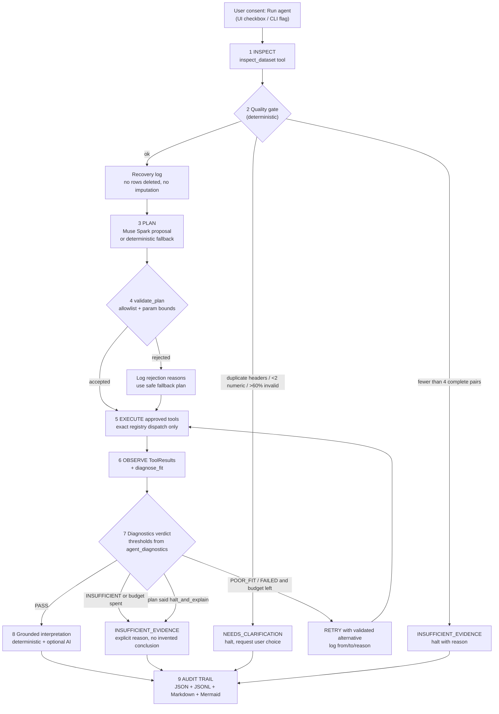

# Analysis Orchestrator - agent workflow

This document describes the bounded, observable, testable agent added on branch
`arena/1f347bab-meta-hackathon`. It is implemented in
`agent_tools.py`, `agent_planner.py`, `agent_diagnostics.py`, `agent_audit.py`,
`agent_core.py`, `run_agent_demo.py`, plus step H in `general_app.py` and
`--agent` in `analyze_dataset.py`.

**The claim is narrow and testable:** Muse Spark (or an offline fallback)
proposes a plan; the plan is strictly validated; the validated tool sequence is
actually executed; the resulting diagnostics deterministically control retries;
the final conclusion is assembled from executed tool outputs; every decision is
recorded in an exportable audit trail. Numerical values are never produced by
the language model.

## Workflow diagram



## State machine

`READY -> INSPECTING -> QUALITY_GATE -> PLANNING -> VALIDATING -> EXECUTING -> OBSERVING -> (RETRYING) -> INTERPRETING -> DONE | INSUFFICIENT_EVIDENCE | NEEDS_CLARIFICATION | FAILED_BOUNDS`

## Tool registry

See `docs/TOOL_REGISTRY.md`. Ten tools, all thin wrappers over existing pure
helpers in `data_io.py`, `column_inference.py`, `cleaning.py`,
`statistics_core.py`, `fitting_core.py` and `visualization_core.py`.

Dispatch is `TOOL_REGISTRY[name].fn(ctx, validated_params)`. There is no
`eval`, `exec`, dynamic import, subprocess call, or model-supplied path. A
static test reads `agent_tools.py` source and asserts those primitives are
absent; the plan validator additionally rejects strings containing `import `,
`eval(`, `exec(`, `subprocess`, `os.system`, `__`, `lambda `, `open(` and code
fences.

## Plan contract

Muse Spark receives **only** a data-quality summary plus `registry_manifest()`
(no raw rows). It returns:

```json
{
  "dataset_understanding": "<=40 words",
  "steps": [
    {"tool": "allowlisted name", "params": {}, "rationale": "short reason"}
  ],
  "on_poor_fit": {"strategy": "try_alternatives | halt_and_explain",
                  "fallback_models": ["polynomial", "..."]},
  "stop_condition": "short statement"
}
```

`validate_plan()` rejects (before any tool runs): non-objects, extra or missing
top-level keys, >8 steps, empty step lists, unknown tools, unknown step keys,
missing params, duplicate steps, unknown models, degree outside 1-4, invalid
correlation methods, forbidden tokens, invalid strategies, >3 fallback models,
and `halt_and_explain` combined with fallback models. `validate_tool_call()`
repeats parameter validation at execution time (defence in depth), including
exact column existence, integer type checks that reject `bool`, and a
confirmation gate for destructive tools.

## Bounds and safety

| Limit | Value | Enforced by |
| --- | --- | --- |
| Plan steps | 8 | `validate_plan`, `OrchestratorConfig.max_steps` |
| Retries | 2 | `agent_core` retry loop |
| Fit attempts | 3 | `choose_alternative`, retry loop |
| Per-tool wall time | 5 s | `ThreadPoolExecutor.future.result(timeout=...)` |
| Whole-run wall time | 30 s | monotonic deadline checked before every tool |
| Dataset rows / columns | 50,000 / 20 | `inspect_dataset` |
| Polynomial degree | 4 | plan validation + tool validation |
| Statistics columns per call | 10 | `validate_tool_call` |
| Fallback models | 3 | `validate_plan` |
| Plan / prompt size | 32k / 48k chars | `build_plan_prompt`, `ask_muse` |

Other invariants:

- Raw observations are never deleted. `cleaning.py` adds `__numeric__`
  companion columns; invalid/missing/non-finite cells are excluded from fitting
  by pairwise completeness only. Case C asserts all 9 rows survive with 6
  usable pairs.
- Nothing is imputed and nothing is coerced to zero.
- Destructive tools require `user_confirmed=True`; the UI exposes a separate,
  default-off checkbox. No built-in plan uses them.
- The only external side effect is the optional Muse Spark call, gated by an
  explicit UI checkbox / CLI flag **and** the presence of `BASETEN_API_KEY`.
- The agent may conclude `INSUFFICIENT_EVIDENCE` or `NEEDS_CLARIFICATION`.
- If the provider is unavailable, `deterministic_plan()` supplies a
  schema-aware plan through the same validated dispatch; the standard A-G
  pipeline (steps A-G in `general_app.py`) never depends on the agent.

**Documented limitation:** a timed-out tool runs in a shared thread pool and is
abandoned (its result discarded) rather than forcibly killed, because pure
NumPy work cannot be interrupted portably on Windows. The run still halts
within its global deadline.

## Diagnostics policy (deterministic, not AI)

`agent_diagnostics.diagnose_fit()` returns `PASS`, `POOR_FIT`, `FAILED` or
`INSUFFICIENT`:

- `FAILED`: fit did not converge.
- `INSUFFICIENT`: R² undefined, or fewer than 4 observations, or fewer than
  `n_parameters + 2` observations (no residual degree of freedom).
- `POOR_FIT`: `R² < 0.80`, or `adjusted R² < 0.70`, or a residual sign-runs
  test shows structure (ratio < 0.20 or > 0.80). Round-off residuals below
  `1e-10 * max|residual|` are ignored so an exact synthetic fit is not
  falsely flagged.
- `PASS`: all thresholds met.

The quality gate halts on duplicate raw headers, fewer than two numeric
columns, >60% invalid cells in X or Y, or fewer than four complete X/Y pairs.

## Audit trail

`agent_audit.AgentRun` writes:

- `agent_audit.json` - full structured record: `plan_source`, `plan_hash`,
  `quality_summary`, `plan_validation` (including rejection reasons),
  `events`, `retries`, `tool_results`, `decisions`, `final`, `totals`.
- `agent_events.jsonl` - one JSON object per event.
- `agent_report.md` - human-readable report plus a Mermaid timeline.

Each event records `seq`, `phase`, `actor` (`ai` / `deterministic`), `tool`,
`params`, `status`, `duration_ms`, `result_digest`, `decision`, `warnings`.
The final conclusion carries `evidence_refs` pointing to real event sequence
numbers. The visual UI table labels every row **AI DECISION** or
**DETERMINISTIC TOOL / POLICY**.

## Final interpretation and grounding

`deterministic_conclusion()` always builds the conclusion from the last
successful fit's tool output (model, n, equation, R², RMSE, retries). When a
key is configured, `generate_grounded_interpretation()` additionally asks Muse
Spark for report sections using **only** `digest_for_ai()` — tool results and
decisions, no raw rows and no prior AI text. `grounding_check()` extracts every
numeric token from the AI prose and rejects the whole report if any number does
not appear (within 1e-6 relative tolerance) in the executed tool outputs. A
rejected report is logged and the deterministic conclusion is retained.

## Three reproducible demo cases

Run offline, no key required:

```bash
python run_agent_demo.py --case all --strict --output-dir outputs/agent_demo
```

| Case | Synthetic data (known properties) | Expected, tested behaviour |
| --- | --- | --- |
| **A** | `case_a_linear.csv`: 20 rows, `y = 3.25x - 1.7` + N(0, 0.05), plus `sigma_y` | Plan validates; linear fit passes; **0 retries**; `DONE`; conclusion cites R² ≈ 0.99998 and the computed slope. |
| **B** | `case_b_curved.csv`: 25 rows, `y = 1.5 - 0.7x + 0.35x²` + noise | Initial linear fit is poor (R² ≈ 0.46, structured residuals); agent selects the validated `polynomial` alternative, **1 retry**; second fit `DONE` with `c2 ≈ 0.348`. |
| **B′** | `case_b_unsalvageable.csv`: 6 rows with a constant response | R² is undefined; agent returns `INSUFFICIENT_EVIDENCE` with an explicit reason and **no fabricated conclusion**. It does not burn the retry budget on models that cannot fit a constant response — an intentional scientific choice. |
| **C** | `case_c_messy.csv`: UTF-8 semicolon file with `oops`, a blank, `inf`, `°` in a header | Quality summary reports missing=1, invalid=1, nonfinite=1; recovery uses pairwise-complete companions; all 9 original rows retained, 6 pairs used; `DONE`. |
| **C′** | `case_c_ambiguous.csv`: duplicate `stimulus` header | `NEEDS_CLARIFICATION` before any fit; zero `fit_curve` events. |

Datasets live in `data/agent_examples/` and are computer-generated, not
experimental evidence.

## Verification matrix

| Behaviour | Implemented | Verified by |
| --- | --- | --- |
| Structured data-quality summary | yes | `test_agent_tools.py`, all 5 demo cases |
| Muse Spark proposes a plan | yes | fake-client tests in `test_agent_planner.py`; **live provider unverified** (no key) |
| Strict plan validation before execution | yes | 12 parametrized rejection tests + orchestrator rejection test |
| **Validated plan controls tool selection** | yes | `test_two_different_valid_ai_plans_produce_different_tool_sequences` (different tool sequences + different plan hashes), `test_rejected_ai_plan_never_executes_its_tools`, `test_halt_and_explain_plan_suppresses_retries` |
| Deterministic tool execution, no arbitrary code | yes | static source test + dispatch tests + numerical equality against `fit_model` directly |
| Result inspection and poor-fit detection | yes | `test_agent_diagnostics.py`, case B |
| Bounded retry / alternative selection | yes | case B, `max_retries=0` test, `choose_alternative` tests |
| Insufficient evidence / clarification halts | yes | cases B′ and C′, quality-gate tests |
| Grounded final interpretation | yes | `grounding_check` tests, rejected-report orchestrator test; live AI unverified |
| Complete audit trail + evidence refs | yes | `test_agent_audit.py`, demo artifact tests |
| Retry / step / time / size / complexity limits | yes | constants + deadline test + validator tests |
| Consent for destructive / external actions | yes | `test_destructive_tool_requires_user_confirmation`, `test_agent_ui.py` |
| Standard pipeline works without AI | yes | full existing suite (A-G) + no-key demo/UI tests |
| **Live Muse Spark plan -> execution** | code path present | **NOT verified** - no `BASETEN_API_KEY` in this environment |

## Known issue fixed in this change

A workspace snapshot re-encoded the checked-in cp1252 example
`data/examples/synthetic_messy_semicolon.csv` (single `0xB0` became UTF-8
`EF BF BD`, U+FFFD), so two tests that asserted `encoding == "cp1252"` failed
for the wrong reason. The shipped example is now honest UTF-8, and all
encoding-fallback assertions generate cp1252/latin-1 bytes in memory at test
time (see `tests/test_encoding_fallback.py`). No tracked file now depends on
non-UTF-8 bytes.
